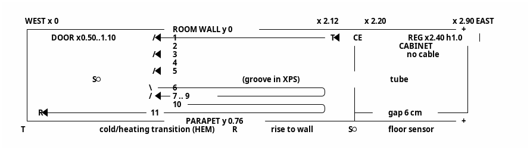
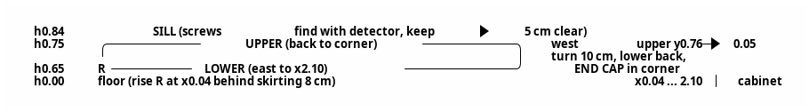

# Мастер-паспорт: тепловая защита и электрообогрев балкона (v2.0)

## 1. Роль
Специалист-теплотехник и строитель.

## 2. Задача

**Цели:**
- устранить конденсат и микросквозняки;
- снизить теплопотери через остекление;
- держать на балконе +20…+22 °C при закрытой двери в комнату;
- учесть лето: мобильный кондиционер, перегрев.

**Этапы:**
1. Ранжирование решений для остекления. Выполнено, выбран вариант 2.
2. Проект электрообогрева: кабель в полу и в парапете под окном. Нужны расчёт, схемы и технология укладки в стену.

## 3. Исходные данные

| Параметр | Значение |
|---|---|
| Ориентация | Юго-восток. Климат: юг РФ, зима в среднем 0 °C, минимум −15 °C; лето +30 °C, максимум +45 °C |
| Балкон | 2,90 × 0,76 м, высота 2,40 м. Координаты: x — от западного торца; y — от стены комнаты (0) к парапету (0,76); h — от чистого пола |
| Остекление | Одинарное, от h 0,84 м, высота ≈ 1,56 м. Улица ≈ 2,90 м и запад ≈ 0,76 м — раздвижное. Восток — глухое, утепляется под шкаф |
| Подоконник | Узкий, выступ за плоскость ГКЛВ 10 мм, крепится саморезами (шаг неизвестен) |
| Парапет (снаружи внутрь) | Кровельное железо → пенопласт 30 → решётка → ЭППС 30 → Теплоизол 5 (фольга внутрь) → каркас, стойки с шагом 40 см → ГКЛВ 12,5 (смонтирован) → отделка |
| Пол (снизу вверх) | Плита → перлитобетон 8–10 см → ЭППС 20 → ЭППС с покрытием 10 →  → керамогранит |
| Стена комнаты | Кирпич или бетон, 0,35 м, ненесущая. Дверь x 0,50…1,10, открывается в комнату. Простенок 0,10 м. Окно комнаты x 1,20…2,50, глухое. Радиатор в комнате при x ≤ 2,10, без термоголовки |
| Шкаф (восток) | Нижняя секция x 2,20…2,90, глубина 0,70 от стены комнаты, зазор 6 см до парапета. Ниша-полка 0,2 м (h ≈ 0,9…1,1), открыта на запад. Верхняя секция x 2,50…2,90, глубина 0,70. Над нижней секцией при x 2,20…2,50 стена открыта |
| Сеть | Линия с УЗО 30 мА, автомат 16 А |
| Бюджет | Без ограничений |

## 4. Решения (действующая редакция)

| № | Решение |
|---|---|
| Р1 | Уличная и западная створки зимой закрыты глухо, без проветривания |
| Р2 | Восточный торец утепляется стационарно по стеклу под шкаф: PIR или ЭППС 30–50 мм, фольга к стеклу, на уплотнитель, без сплошной приклейки |
| Р3 | С остеклением работаем только текстилем, карнизами и съёмной плёнкой. Исключение — восток |
| Р4 | Основное отопление — электрообогрев пол + стена. Конвектор ≈ 0,5–1 кВт с термостатом — резерв в мороз |
| Р5 | Источники влаги возможны, но в мороз бельё на балконе не сушится. Влажность ≤ 45–50 % |
| Р6 | Свет зимой не критичен, шторы закрыты |
| Р7, Р8 | Штора от потолка до подоконника с прижимом. Летний режим учитывается |
| Р13 | **Выбран вариант 2:** сотовая плиссе (honeycomb blackout) в боковых П-профилях + термоусадочная плёнка на раму. Замена плиссе — ZIP-штора blackout или термо. Периметр шторы уплотняется обязательно: верх, бока, низ |
| Р17 | Один регулятор, без ограничителя стены. Полоса стены h 0,55…0,84 свободна от мебели, предметов и крепежа |
| Р18 | Регулятор ТеплоСофт E51.716 (IP20, работает от −5 до +50 °C) в накладной коробке на стене комнаты: x ≈ 2,40, h 1,0, в открытой нише над нижней секцией шкафа |
| Р25 | Встроенный датчик воздуха управляет, выносной датчик пола ограничивает 30 °C. Датчик воздуха калибруется по термометру в центре балкона на h 1,2 (допуск ±0,5 °C). Зимой дежурный режим не ниже +10 °C, летом регулятор выключен |
| Р26 | Розетка переносится из шкафа: x ≈ 2,15, h 0,30. Регулятор питается шлейфом от её клемм |
| Р29 | Холодный конец, гофра датчика и питание идут в штробах стены комнаты, за нижней секцией шкафа |
| Р20, Р39 | Подъём кабеля в парапет — западно-уличный угол. На стене: нижняя нитка → верхняя → запад U-петлёй, концевая заделка в углу |
| Р34 | На стене без теплоизоляции и фольги под кабелем. Кабель полностью в клее, без пустот |
| Р38 (ред.) | **Кабель Hemstedt DR 12,5 Вт/м** (Ø 4,5 мм; R изгиба ≥ 5Ø ≈ 25 мм; холодный конец 4 м, 2 × 1,0; монтаж при t ≥ +5 °C) в плиточном клее, без стяжки. Решения о ТЛБЭ и стяжке отменены |
| Р33 (ред. 2) | Секция DR 30 м, ≈ 375 Вт: пол ≈ 23,3 м, стена ≈ 6,7 м. Вариант 24 м отклонён: мала мощность при основном отоплении |
| Р40 | Стена: кабель на поверхности ГКЛВ без штроб. Клей для тёплых полов → шпаклёвка по сетке → флизелин. Общий слой ≤ 8 мм (подоконник выступает на 10 мм) |
| Р41 | Пол: утапливающий слой клея 6–7 мм + облицовочный 4–5 мм под плитку |
| Р42 | Гофра датчика пола идёт в пазу, прорезанном в ЭППС: в клее она не помещается |

## 5. Теплотехника (ключевые выводы)

- **Потери без мер.** Стекло U ≈ 5,8 Вт/м²·К, площадь ≈ 5,7 м². Потери ≈ 0,9 кВт при 0 °C и ≈ 1,5 кВт при −15 °C.
- **Потери с вариантом 2.** U ≈ 1,7. Потери ≈ 260 Вт при 0 °C и ≈ 400 Вт при −15 °C. Через парапет ещё ≈ 40 / 70 Вт.
- **Предел пола.** Ограничивает температура поверхности 30 °C: полезная отдача ≈ 90–110 Вт/м².
- **Стена под окном.** Даёт восходящий поток под шторой и гасит холодный нисходящий поток.
- **Конденсат.** На одинарном стекле его не устранить полностью, задача — вынести его за плотный тёплый слой. Правило: внутренний слой плотнее наружного, наружное остекление не герметизировать.

## 6. Ранжирование решений для остекления (кратко)

| Ранг | Решение | U | Потери −15 / 0 °C, Вт |
|---|---|---|---|
| 1 | Съёмные панели ЭППС или PIR 30–50 мм + плёнка | ≈ 0,7 | 200 / 110 |
| **2 ✔** | **Сотовые плиссе в направляющих + плёнка** | **≈ 1,7** | **400 / 260** |
| 3 | Рулонная термоштора в направляющих + плёнка (ZIP ≈ 2,0) | ≈ 2,2 | 520 / 340 |
| 4–7 | Рулонная без плёнки, портьеры, только плёнка, обычные рулонные | 2,8–4,5 | 650…1200 |
| — | Без мер | 5,8 | 1500 / 900 |

## 7. Расчёт секции Hemstedt DR 30 м

| № | Параметр | Значение | Обоснование |
|---|---|---|---|
| 7.1 | Зона обогрева пола | x 0…2,20, y 0…0,76; 1,67 м² | Зона шкафа исключена |
| 7.2 | Зона укладки | x 0,04…2,12, y 0,05…0,71 | Отступ от шкафа 8 см, от стен 4–5 см |
| 7.3 | Стена | ≈ 6,7 м | Подъём 0,7 + улица 2 × 2,10 + запад 2 × 0,71 + развороты ≈ 0,4 |
| 7.4 | Пол | 30 − 6,7 = 23,3 м | — |
| 7.5 | Нитки пола | 11 × 2,08 м = 22,9 м + 10 разворотов ≈ 0,4 м | Нечётное число: финиш в западно-уличном углу |
| 7.6 | Шаг пола | 6,6 см, R разворота 33 мм ≥ 25 мм | (0,71 − 0,05) / 10 |
| 7.7 | Мощность пола | ≈ 291 Вт | ≈ 174 Вт/м² на зону, ≈ 212 Вт/м² на площадь укладки |
| 7.8 | Мощность стены | ≈ 84 Вт, шаг ниток 10 см | ≈ 125 Вт/м² полосы, поверхность ≈ 33–36 °C |
| 7.9 | Итого | ≈ 375 Вт при 230 В (≈ 358 Вт при 220 В), ток ≈ 1,6 А | — |
| 7.10 | Баланс | Без конвектора — до ≈ −6…−8 °C | Ниже включается резервный конвектор (Р4) |
| 7.11 | Холодный конец | Трасса ≈ 1,4 м из 4 м | Излишек укоротить: режется только холодный конец |
| 7.12 | Подстройка на месте | Восточные развороты в пределах x 2,08…2,12 | Греющую часть не резать. Длина на стене фиксирована |

## 8. Схема пола

| Нитка | y, м | Направление |
|---|---|---|
| 1, 3, 5, 7, 9, 11 | 0,05; 0,182; 0,314; 0,446; 0,578; 0,71 | на запад |
| 2, 4, 6, 8, 10 | 0,116; 0,248; 0,38; 0,512; 0,644 | на восток |

| Узел | Координаты / исполнение |
|---|---|
| T — переход HEM | x ≈ 2,12, y 0,05, прямой участок, отметить на фото |
| Датчик S* | x ≈ 1,55, между нитками 6 и 7 (y ≈ 0,41). Гофра 16 мм с заглушкой в пазу ЭППС, кабель не пересекает |
| R — подъём | x 0,04, y 0,71 → 0,76, поворот R ≥ 25 мм. Демпферная лента подрезается по месту |

**Пирог пола:**
1. ЭППС с покрытием (основание прочное, обеспыленное, загрунтованное).
2. Демпферная лента по периметру.
3. Монтажная лента.
4. Кабель DR.
5. Утапливающий слой клея C2 для тёплых полов, 6–7 мм.
6. Облицовочный слой клея 4–5 мм.
7. Керамогранит.

Пол поднимается на ≈ 20 мм. Включать нагрев через 28 суток по клею.

## 9. Схема стены (парапет, уличная сторона + запад)

## 10. Технология укладки на ГКЛВ (без штроб)

| № | Операция |
|---|---|
| 1 | Найти саморезы подоконника и стойки каркаса (шаг 40 см). Разметить нитки h 0,65 и 0,75 |
| 2 | Загрунтовать ГКЛВ. Замерить сопротивление жил и изоляции кабеля, записать в протокол |
| 3 | Закрепить кабель монтажной лентой или клипсами на клею. Развороты R ≥ 25 мм. Ниток не касаться |
| 4 | Утопить кабель клеем C2 для тёплых полов: слой 6–7 мм над ГКЛВ, без пустот. Повторный замер |
| 5 | Утопить стеклосетку в шпаклёвку, общий слой ≤ 8 мм. Выравнивать всю плоскость парапета (h 0…0,84), чтобы не было полосы. Стык с подоконником (≈ 2 мм) закрыть эластичным герметиком |
| 6 | Флизелиновые обои. Сделать фото-исполнительную схему. Ввести запрет на сверление в полосе h 0,55…0,84 |

## 11. Приёмка

| № | Критерий | Метод |
|---|---|---|
| 1 | Сопротивление в норме до монтажа, после клея и после отделки | Мультиметр, мегаомметр, протокол |
| 2 | Шаг ≥ 5 см, R ≥ 25 мм, пересечений нет | Рулетка, фото |
| 3 | Датчик пола извлекается из гофры | Проба до укладки клея |
| 4 | Пол ≤ 30 °C, стена ≤ 40 °C, воздух +20…+22 °C (±0,5) | ИК-термометр, контрольный термометр на h 1,2 |
| 5 | Влажность ≤ 50 % | Гигрометр с памятью min/max |

## 12. Открытые вопросы

| № | Вопрос |
|---|---|
| 1 | Высота порога двери: допустим ли подъём пола на ≈ 20 мм? |
| 2 | От какого уровня отсчитана высота h 0,84 (основание или чистый пол)? Влияет на h ниток |
| 3 | Покрытие ЭППС 10 мм подходит под плиточный клей? Проверить по паспорту |

## 13. Статус и следующие шаги

- **Выполнено:** ранжирование, выбор варианта 2, место регулятора, расчёт DR 30 м, схемы пола и стены.
- **Далее:** детальная технология пола, спецификация материалов, монтаж шторы.

## 14. Версионность

| Версия | Изменение |
|---|---|
| 1.0–1.5 | Постановка, решения Р1–Р8, ранжирование, вариант 2 |
| 1.6 | Геометрия 2,90 × 0,76, шкаф, решения Р9–Р30 (регулятор, розетка) |
| 1.7–1.8 | ТЛБЭ 25 м, схема пола, перевод на стяжку |
| **2.0** | Замена на Hemstedt DR 30 м в клее: Р33, Р38 (ред.), Р40–Р42. Выступ подоконника 10 мм. Самодостаточный паспорт |