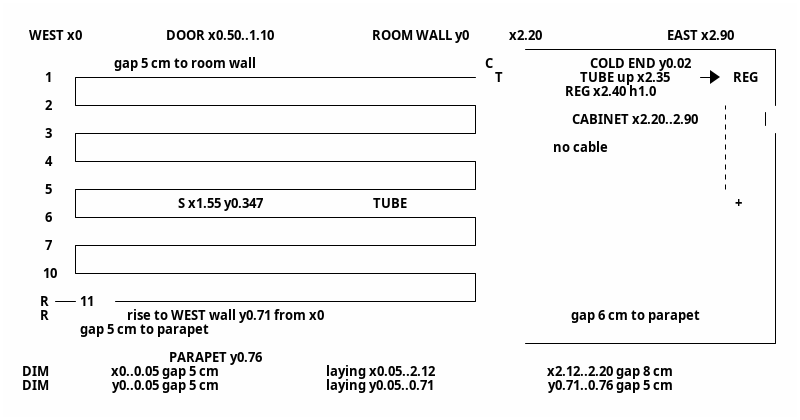
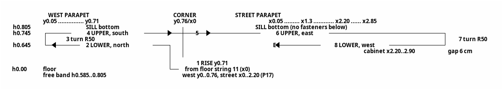
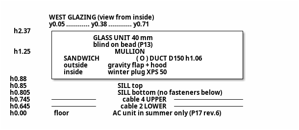
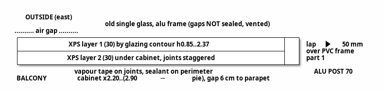

# Мастер-паспорт v2.7 — полная редакция

**Постановка:** выводится полный текст паспорта v2.7 со всеми разделами и схемами, без отсылок к v2.6. Содержание не меняется: включены изменения по востоку (Р53) и западу (Р54), ТЗ ред. 7. Уточняющих вопросов нет.

---

# Мастер-паспорт: тепловая защита и электрообогрев балкона (v2.7)

## 1. Роль
Специалист-теплотехник и строитель.

## 2. Задача

**Цели:**
- устранить конденсат и сквозняки;
- снизить теплопотери через остекление;
- держать на балконе +20…+22 °C при закрытой двери в комнату;
- учесть лето: мобильный кондиционер, перегрев.

**Этапы:**
1. Остекление:
   - улица и запад — ПВХ-окна со стеклопакетами (Р43), ТЗ ред. 7 (раздел 11);
   - восток — существующее остекление, изнутри пирог ЭППС (Р53);
   - запад — проход под гофру кондиционера (Р54).
2. Электрообогрев: кабель в полу и в парапете под подоконником (сценарий В). Расчёт и схемы выполнены.
   - Отступы ≥ 5 см (Р48).
   - Нитки стены привязаны к низу подоконника (Р49).
   - Датчик пола — между нитками 5 и 6 (Р51).
   - Трасса стены «запад + улица», одна нитка непрерывно проходит по обоим парапетам (Р52 ред. 2).
3. Далее: детальная технология пола, спецификация, выбор штор, выбор кондиционера.

## 3. Исходные данные

Все высоты h — от чистого пола.

| Параметр | Значение |
|---|---|
| Ориентация, климат | Юго-восток. Краснодар: зима в среднем 0 °C, минимум −15 °C; лето +30 °C, максимум +45 °C |
| Балкон | 2,90 × 0,76 м, высота до потолка 2,41 м. Координаты: x — от западного торца; y — от стены комнаты (0) к парапету (0,76); h — от чистого пола |
| Подоконник | ПВХ на стальной обрешётке, толщина 45 мм: низ h ≈ 0,805, верх h ≈ 0,85. Поверх — подставочный профиль рамы (≈ 30 мм). Выступ за плоскость ГКЛВ 10 мм |
| Остекление | Проём от верха подоконника до верхнего ригеля: h 0,85…2,37 (1,52 м). Подставочный профиль входит в проём, низ рамы h ≈ 0,88. Верхний ригель h 2,37…2,41. **Улица** 2,90 м: 4 части по ≈ 0,725 м, счёт от востока. Часть 1 глухая; 2 — поворотно-откидная, петли с востока; 3 глухая; 4 — поворотно-откидная, петли с запада. **Запад** 0,76 м — глухое ПВХ с импостом h ≈ 1,25: внизу сэндвич с проходом под гофру, вверху пакет (Р54). **Восток** 0,76 м — существующее глухое одинарное стекло в алюминиевой раме, сохраняется. Изнутри пирог ЭППС (Р53) |
| Каркас | Алюминий без терморазрыва. Остаются верхний ригель и угловые несущие стойки 70 мм. Нижний ригель улицы и запада демонтируется (Р43). Стойка «восток – улица»: с одной стороны — старая алюминиевая рама востока, с другой — ПВХ-рама части 1 |
| Парапет, уличный и западный (снаружи внутрь) | Кровельное железо → пенопласт 30 → решётка → ЭППС 30 → Теплоизол 5 (фольга внутрь) → каркас, стойки с шагом 40 см → ГКЛВ 12,5 → отделка. Западный — той же конструкции, мебели нет |
| Пол (снизу вверх) | Плита → перлитобетон 8–10 см → ЭППС 20 → ЭППС с покрытием 10 → кабель в клее (≈ 11 мм) → керамогранит (≈ 9 мм). Над перлитобетоном ≈ 50 мм |
| Стена комнаты | Кирпич или бетон, 0,35 м, ненесущая. Дверь x 0,50…1,10, открывается в комнату. Окно комнаты x 1,20…2,50, глухое. Радиатор в комнате при x ≤ 2,10, без термоголовки |
| Шкаф (восток) | Нижняя секция x 2,20…2,90 (восточная граница — с учётом пирога, вопрос 11), глубина 0,70, зазор 6 см до парапета. Ниша-полка h ≈ 0,9…1,1, открыта на запад. Верхняя секция x 2,50…2,90. При x 2,20…2,50 стена над нижней секцией открыта |
| Кондиционер | Мобильный, один рукав Ø 130 или 150, модель не выбрана. Летом стоит на полу у западной стены, зимой убирается |
| Сеть | Линия с УЗО 30 мА, автомат 16 А |
| Датчик пола | NTC в комплекте регулятора, кабель 2,5 м |
| Бюджет | Без ограничений |

## 4. Решения (действующая редакция)

| № | Решение |
|---|---|
| Р1 (ред.) | Створки зимой закрыты, приток только через клапан (Р45) |
| **Р2 (ред. 2)** | Восток: существующее глухое остекление изнутри закрывается пирогом ЭППС. — Слой 1 по контуру остекления, слой 2 под шкаф. Ориентир 30 + 30 мм, итог — вопрос 11. — Монтаж на уплотнитель, без сплошной приклейки. — Детали — Р53 |
| Р3 | Отменено, заменено Р43 |
| Р4 | Основное отопление — электрообогрев пол + стена. Конвектор ≈ 0,5–1 кВт с термостатом — резерв в мороз |
| Р5 | Бельё в мороз на балконе не сушится. Влажность ≤ 45–50 % |
| Р6 | Свет зимой не критичен |
| Р7, Р8 (ред.) | «Штора от потолка с прижимом» отменена. Летний режим учитывается (Р13) |
| **Р13 (ред. 2)** | Натяжное плиссе или кассетные жалюзи на леске, на каждую часть, крепление на штапик. Без боковых направляющих и уплотнения, зазор у стекла 1–2 см. Тип — открытый вопрос. На западе — только верхнее поле, выше импоста |
| **Р17 (ред. 6)** | Один регулятор, без ограничителя стены. Свободная полоса h ≈ 0,585…0,805 (от низа подоконника −22 см до низа подоконника) без мебели и предметов: — уличный парапет x 0…2,20 на всей длине, в том числе там, где одна нитка; — западный парапет целиком, y 0…0,76. Крепёж в уличный и западный парапет ниже низа подоконника запрещён. Зазор 6 см за шкафом открыт сверху и снизу. Летнее исключение: кондиционер у западной стены допускается только при выключенном регуляторе (Р25). Зимой полоса свободна |
| Р18 | Регулятор ТеплоСофт E51.716 (IP20, от −5 до +50 °C) в накладной коробке: x ≈ 2,40, h 1,0, в нише над шкафом |
| Р25 | Управляет встроенный датчик воздуха. Выносной датчик пола ограничивает 30 °C. Калибровка по термометру в центре на h 1,2 (±0,5 °C). Зимой дежурный режим ≥ +10 °C, летом регулятор выключен |
| **Р26 (ред.)** | Розетка переносится: x ≈ 2,15, h 0,30. Регулятор питается шлейфом от её клемм. Летом от неё же питается кондиционер (≤ 16 А, без удлинителя) |
| Р29 | Холодный конец, гофра датчика и питание — в штробах стены комнаты за нижней секцией шкафа |
| Р20, Р39 (ред. 5) | Порядок хода: ① нитка 11 продолжается от x 0,05 до x 0, подъём на западный парапет при y 0,71 до h ≈ 0,645; ② нижняя нитка по западному парапету на север, y 0,71 → 0,05; ③ разворот R 50; ④ верхняя нитка h ≈ 0,745 на юг, y 0,05 → 0,71; ⑤ поворот за угол R ≥ 25 мм; ⑥ верхняя нитка по уличному парапету на восток, x 0,05 → 2,85; ⑦ разворот R 50 в зазоре за шкафом; ⑧ нижняя нитка на запад до x ≈ 1,3 (точно — по месту); E — концевая заделка |
| Р34 | На стене без теплоизоляции и фольги под кабелем, кабель полностью в клее |
| Р38 | Hemstedt DR 12,5 Вт/м: Ø 4,5 мм, R изгиба ≥ 25 мм, холодный конец 4 м, 2 × 1,0, монтаж при t ≥ +5 °C. В плиточном клее, без стяжки |
| Р33 (ред. 5) | DR 30 м, ≈ 375 Вт: пол ≈ 23,2 м (11 ниток), стена ≈ 6,8 м (запад — 2 нитки; улица — верхняя нитка полная, нижняя укороченная). DR 24 м мал, DR 80 м избыточен |
| Р40 | Стена: кабель на ГКЛВ без штроб, клей для тёплых полов → шпаклёвка по сетке → флизелин, слой ≤ 8 мм |
| Р41 | Пол: утапливающий слой клея 6–7 мм + облицовочный 4–5 мм |
| Р42 | Гофра датчика пола — в пазу ЭППС (трасса по Р51) |
| **Р43 (ред. 2)** | ПВХ-окна в проёме каркаса, 2 пролёта: улица и запад. Профиль 58–70 мм, ≥ 3 камер, Uf ≤ 1,6, предпочтительно 58–60 мм. Пакет 4i-14Ar-4-14Ar-4i (40 мм), при несовместимости — 4i-10Ar-4-10Ar-4i (32 мм). Нижний ригель демонтируется после подтверждения, что он не несущий. Восток не меняется (Р53) |
| **Р44 (ред. 2)** | Верхний ригель закрыт пароплотно (≥ 13 °C при −15 °C). Узел «запад – улица»: полость утепляет подрядчик (≥ 10 °C). Узел «восток – улица»: внутреннюю грань стойки закрывает заказчик (Р53) |
| **Р45 (ред.)** | Регулируемый клапан в раме створки 2, зимой 5–10 м³/ч. Летом — основной приток при работе кондиционера |
| Р46 | Принят сценарий В (пол + стена под подоконником). А и Б отклонены |
| Р47 (ред.) | Пол: шаг ≥ 6 см. Стена: шаг 10 см (минимум 8 см): стена без ограничителя, поверхность ≤ 40 °C |
| Р48 (ред.) | Отступ кабеля от стен, углов и примыканий ≥ 5 см (технологический минимум). От шкафа на полу — 8 см. Высвобождаемая длина уходит в нижнюю уличную нитку ⑧ |
| Р49 | Все h — от чистого пола. Репер разметки стены — низ подоконника: верхняя нитка на 6 см ниже, нижняя на 16 см ниже, свободная полоса — от 22 см ниже до низа подоконника. Цифры h справочные, при расхождении действует репер |
| **Р50 (ред.)** | Подъём пола над ЭППС ≈ 20 мм допустим по порогу. Покрытие ЭППС 10 мм подходит под плиточный клей. Порядок работ: окна → разметка стены → кабель за шкафом → пирог востока → установка шкафа. Кабель за шкафом укладывается до установки шкафа или со снятой боковиной |
| Р51 | Датчик пола: x ≈ 1,55, между нитками 5 и 6 (y ≈ 0,347). Промежуток 5–6 открыт на восток, гофра выходит без пересечения кабеля. Трасса гофры: на восток по y 0,347 до x ≈ 2,35 (под шкафом) → на север до стены комнаты → вертикальная штроба при x ≈ 2,35 до регулятора h 1,0. Длина ≈ 2,25 м из 2,5 м, запас ≈ 0,25 м. Холодный конец от T идёт вдоль стены комнаты (y ≈ 0,02) до x ≈ 2,25, западнее гофры, не пересекается с ней |
| Р52 (ред. 2) | Трасса стены — по Р20/Р39 (ред. 5): по западному парапету две нитки, верхняя нитка непрерывно переходит с запада на улицу. Пересечений нет: подъём доходит только до нижней нитки, нитка ⑧ заканчивается при x ≈ 1,3. Участок с одной ниткой — улица x 0,05…≈ 1,3, принят: низ края пакета греет верхняя нитка, угол — западные нитки и пол. Проверка тепловизором (раздел 12, п. 5). Отклонены: «подъём на верхнюю нитку» (пересечение), «западный хвост 0,36 м» (v2.5) |
| **Р53** | **Восток — существующее остекление + пирог ЭППС:** 1. Старое глухое стекло и алюминиевая рама сохраняются. Щели снаружи не герметизировать: полость вентилируется наружу. 2. Слой 1 ЭППС по контуру проёма, слой 2 под шкаф, швы вразбежку. 3. Внутренний контур пароплотный: швы — пароизоляционная лента, периметр — герметик. 4. Стойку «восток – улица» 70 мм закрывает ЭППС с нахлёстом ≥ 50 мм на ПВХ-раму части 1, стык — пароизоляционная лента. 5. Открытого алюминия изнутри нет. 6. Пирог только на высоте остекления (h ≥ 0,85). Кабель за шкафом и разворот ⑦ не перекрывает |
| **Р54** | **Запад — проход под гофру кондиционера (вариант А):** 1. Импост h ≈ 1,25. Нижнее поле h 0,88…1,25 — ПВХ-сэндвич 24–32 мм с ЭППС-сердечником. Верхнее поле h 1,25…2,37 — пакет по Р43. 2. Проходной элемент Ø 150, ось y ≈ 0,38, h ≈ 1,06. Под Ø 130 — переходник. 3. Снаружи — гравитационный клапан с козырьком и сеткой, ставится на панель до монтажа (работы только изнутри). 4. Изнутри — зимняя пробка ЭППС 50 мм на уплотнителе с прижимной крышкой (магнит или байонет). 5. Крепёж в западный парапет ниже подоконника запрещён, гофра к парапету не крепится |

## 5. Теплотехника (ключевые выводы)

| Показатель | Значение |
|---|---|
| Площадь в потерях | 5,56 м² (улица 4,41 + запад 1,16). Восток закрыт пирогом ЭППС и шкафом |
| Uw (П58 + 40 мм) | Улица ≈ 1,06: стекло 67 %, ПВХ 33 %, открытого алюминия нет. Запад с сэндвичем (≈ 0,2 м², U ≈ 1,1–1,3) и импостом ≈ 1,1 |
| H, Вт/К | Окно + узлы + парапет ≈ 9,1. С притоком 5–10 м³/ч — 10,8–12,5 |
| Потери (приток 5–10 м³/ч) | ≈ 225–265 Вт при 0 °C, ≈ 390–450 Вт при −15 °C. Приток 20–30 м³/ч съедает выигрыш окон |
| Температуры при −15 °C | Центр стекла 18,2; край пакета 10,9; низ края с ниткой ≈ 10,5–11; рама 12,4; угловой узел 10; закрытый ригель 13,8; угол за шкафом с нитками 10–12. Сэндвич ≈ 15; пробка ≈ 18; кромка прохода ≈ 12. Пирог востока изнутри ≥ 17; стойка «восток – улица» под ЭППС ≥ 10. Точка росы 9,3 °C |
| Критичные узлы | Низ пакета защищает верхняя нитка (проверка тепловизором, 12.5). Угол за шкафом защищает кабель. Западный парапет греется полностью (2 нитки). Улица x 0,05…≈ 1,3 — одна нитка, принято (Р52 ред. 2). Угловые узлы и ригель — по Р44. Проход под гофру зимой — только с пробкой и закрытым клапаном. Восток: пароизоляция пирога сплошная, иначе конденсат в полости. Штору не уплотнять, ночью приподнимать |
| Запасной пакет 32 мм | +0,75 Вт/К, запас у края ≈ 0,5–1 К, допустимо при влажности ≤ 45 % |
| Лето | Однорукавный кондиционер создаёт разрежение. Приток Р45 открыт полностью, дверь в комнату закрыта |

## 6. Остекление: история выбора

| Этап | Решение |
|---|---|
| v1.x–v2.0 | Одинарное стекло + сотовое плиссе в направляющих + плёнка (U ≈ 1,7) |
| v2.1 | ПВХ-окна со стеклопакетами (Р43). Сравнение — артефакт 1, ред. 3 |
| v2.4 | ТЗ ред. 6 включено в паспорт |
| v2.7 | Восток не меняется, пирог ЭППС (Р53). Запад: импост, сэндвич с проходом (Р54). ТЗ ред. 7 |

## 7. Расчёт секции Hemstedt DR 30 м

| № | Параметр | Значение | Обоснование |
|---|---|---|---|
| 7.1 | Зона обогрева пола | x 0…2,20, y 0…0,76; 1,67 м² | Зона шкафа исключена |
| 7.2 | Зона укладки | x 0,05…2,12, y 0,05…0,71 | Р48: от стен 5 см, от шкафа 8 см. Выход нитки 11 до x 0 — часть подъёма |
| 7.3 | Пол | 11 × 2,07 = 22,8 м + 10 разворотов ≈ 0,4 м ≈ 23,2 м | Нечётное число ниток, финиш в западно-уличном углу |
| 7.4 | Шаг пола | 0,66 / 10 = 6,6 см ≥ 6 см, R 33 мм | Р47 |
| 7.5 | Стена | ① подъём ≈ 0,70 + ② 0,66 + ③ 0,16 + ④ 0,66 + ⑤ угол ≈ 0,10 + ⑥ 2,80 + ⑦ 0,16 + ⑧ ≈ 1,56 ≈ 6,8 м | h ≈ 0,645 / 0,745 (Р49), шаг 10 см, R разворотов 50 мм. Нитка ⑧: x 2,85 → ≈ 1,3 |
| 7.6 | Мощность | Пол ≈ 290 Вт (≈ 174 Вт/м² на зону). Стена ≈ 85 Вт (≈ 110 Вт/м² полосы): — запад с подъёмом и углом ≈ 28 Вт; — улица вне шкафа ≈ 38 Вт; — за шкафом ≈ 18 Вт | 12,5 Вт/м |
| 7.7 | Итого | ≈ 375 Вт при 230 В (≈ 358 Вт при 220 В), ток ≈ 1,6 А | — |
| 7.8 | Поверхности | Пол ≤ 30 °C (датчик). Стена ≈ 33–36 °C (≤ 40 °C), на участке с одной ниткой ниже | Шаг 10 см |
| 7.9 | Баланс | Полезно ≈ 330–345 Вт. Кабель один держит +21 °C до −6…−10 °C | Ниже — конвектор (Р4) |
| 7.10 | Холодный конец | Переход T у x ≈ 2,12, y 0,05 → вдоль стены комнаты (y ≈ 0,02) до x ≈ 2,25 → штроба. Трасса ≈ 1,4 м из 4 м | Укорачивать только холодный конец |
| 7.11 | Подстройка | Только длиной нитки ⑧. Запас в обе стороны — десятки сантиметров. Конец E не западнее x 0,05 | Греющую часть не резать, отступы ≥ 5 см (Р48) |
| 7.12 | Кабель датчика | 0,80 (x 1,55 → 2,35) + 0,35 (y → 0) + 1,00 (штроба до h 1,0) + 0,10 (в коробку) ≈ 2,25 м из 2,5 м | Р51. Если не хватит, датчик сдвигается на восток до x ≈ 1,65 |

Пирог востока зону пола и трассу стены не затрагивает (Р53 п. 6).

## 8. Схема пола

> **Условные обозначения**
> **T** — переход HEM (муфта) в точке x 2,12, y 0,05.
> **C** — холодный конец: вдоль стены комнаты (y ≈ 0,02) до x ≈ 2,25, далее в штробе к регулятору.
> **S** — датчик пола между нитками 5 и 6 (y ≈ 0,347).
> **TUBE** — гофра 16 мм в пазу ЭППС: на восток до x ≈ 2,35, на север до стены, в штробе вверх до регулятора (Р51). Гофра и холодный конец не пересекаются.
> **R** — нитка 11 доводится до x 0, подъём на западный парапет при y 0,71.
> **7** — нитки 7…9 на схеме свёрнуты. Нечётные нитки идут на запад, чётные — на восток. Шаг 6,6 см.
> **DIM** — размерные строки. Зазоры: от западной стены 5 см, от стены комнаты 5 см, от парапета 5 см, от шкафа 8 см.

| Нитка | y, м | Направление |
|---|---|---|
| 1, 3, 5, 7, 9, 11 | 0,05; 0,182; 0,314; 0,446; 0,578; 0,71 | на запад |
| 2, 4, 6, 8, 10 | 0,116; 0,248; 0,38; 0,512; 0,644 | на восток |

| Узел | Исполнение |
|---|---|
| T | x ≈ 2,12, y 0,05, прямой участок, отметить на фото |
| C | Холодный конец вдоль стены комнаты, y ≈ 0,02, x 2,12 → 2,25, далее в штробе |
| S | x ≈ 1,55, y ≈ 0,347 (по ≈ 2,5 см до ниток 5 и 6). Гофра 16 мм с заглушкой в пазу ЭППС, выход на восток через промежуток 5–6, подъём в штробе при x ≈ 2,35 |
| R | Нитка 11: x 0,05 → 0 при y 0,71. Поворот вверх R ≥ 25 мм на западный парапет, демпферная лента подрезается |
| Западные развороты | x 0,05 (зазор 5 см): 1–2, 3–4, 5–6, 7–8, 9–10 |
| Восточные развороты | x 2,12 (зазор до шкафа 8 см): 2–3, 4–5, 6–7, 8–9, 10–11 |

**Пирог пола:** ЭППС с покрытием (загрунтован) → паз под гофру → демпферная лента → монтажная лента → кабель DR → клей C2 6–7 мм → облицовочный клей 4–5 мм → керамогранит. Подъём над ЭППС ≈ 20 мм, допустим (Р50). Нагрев включать через 28 суток.

## 9. Схемы стены и остекления

### 9.1. Развёртка «запад + улица» (Р52 ред. 2)

Вид изнутри балкона, читается слева направо:
- слева — западный парапет, от стены комнаты (y 0,05) к углу (y 0,71);
- в центре — юго-западный угол;
- справа — уличный парапет, x 0,05…2,85.

Порядок хода: ① подъём → ② нижняя на север → ③ разворот → ④ верхняя на юг → ⑤ угол → ⑥ верхняя на восток → ⑦ разворот → ⑧ нижняя на запад → E.

> Отметки h — от чистого пола, справочно. Репер — низ подоконника: верхняя нитка −6 см, нижняя −16 см (Р49).
> Подъём ① доходит только до нижней нитки ②. Верхние нитки ④ и ⑥ проходят над ним, нитка ⑧ кончается при x ≈ 1,3. Пересечений нет.
> E — концевая заделка, место определяется по месту (7.11), фиксируется на фото.

### 9.2. Западное остекление: проход под гофру (Р54)

> Проход выше подоконника и с трассой кабеля не пересекается. Гофра к парапету не крепится.

### 9.3. Восток: пирог ЭППС (Р53), разрез в плане

## 10. Технология укладки на ГКЛВ (без штроб)

| № | Операция |
|---|---|
| 1 | Найти саморезы подоконника и стойки каркаса (шаг 40 см). От низа подоконника вниз отложить 6 и 16 см (h ≈ 0,745 / 0,645). Разметить нитки на западном парапете при y 0,05…0,71 и на уличном при x 0,05…2,85, в том числе в зазоре за шкафом (Р50). Отметить точку подъёма при y 0,71 |
| 2 | Загрунтовать ГКЛВ уличного и западного парапета. Замерить сопротивление жил и изоляции, записать в протокол |
| 3 | Закрепить кабель монтажной лентой или клипсами на клею в порядке ①–⑧ (раздел 9.1). Развороты ③ и ⑦ — R ≥ 25 мм (по шагу 50 мм), ниток не касаться. Поворот в углу ⑤ — R ≥ 25 мм, отступ от угла ≥ 5 см. Длину нитки ⑧ определить по месту, положение E отметить |
| 4 | Утопить кабель в клей C2 без пустот. Повторный замер |
| 5 | Стеклосетка в шпаклёвку, общий слой ≤ 8 мм. Выравнивать весь уличный и западный парапет от пола до низа подоконника. Стык с подоконником — эластичный герметик |
| 6 | Флизелин. Фото-исполнительная схема. Запрет сверления ниже низа подоконника на уличном и западном парапете. Кондиционер летом ставится без крепления к парапету, гофра не крепится хомутами к ГКЛВ |

### 10а. Пирог востока (Р53)

| № | Операция |
|---|---|
| 1 | После укладки кабеля за шкафом очистить старое остекление. Щели снаружи не закрывать |
| 2 | Слой 1 ЭППС 30 по контуру проёма h 0,85…2,37, на уплотнитель |
| 3 | Нахлёст на стойку «восток – улица» и ПВХ-раму ≥ 50 мм, стык — пароизоляционная лента |
| 4 | Слой 2 ЭППС 30, швы вразбежку, проклейка лентой, по периметру герметик |
| 5 | Фото до установки шкафа |

### 10б. Сезонный режим прохода (Р54)

| Сезон | Действие |
|---|---|
| Зима | Кондиционер убран. Пробка установлена, крышка прижата. Гравитационный клапан закрыт |
| Лето | Регулятор выключен (Р25). Пробка снята, гофра через переходник в проходной элемент. Клапан Р45 открыт полностью, дверь в комнату закрыта |

## 11. ТЗ для подрядчика, ред. 7

**ТЕХЗАДАНИЕ: монтаж ПВХ-окон в проём алюминиевого каркаса балкона**

**Объект:** балкон, г. Краснодар.

| Пролёт | Проём | Площадь |
|---|---|---|
| Уличный | 2,90 × 1,52 м (наружный размер каркаса 2,96 м) | 4,41 м² |
| Западный | 0,76 × 1,52 м, с импостом и сэндвич-панелью (раздел 5) | 1,16 м² |
| **Итого** | | **5,56 м²** |

Высота проёма 1,52 м — от верха подоконника до верхнего ригеля, подставочный профиль входит в этот размер. Справочно от чистого пола: h ≈ 0,85…2,37.

**Восточный пролёт в объём работ не входит.** Существующее остекление не демонтируется и не повреждается.

### 1. Условия

| № | Условие |
|---|---|
| 1.1 | Сохраняются несущие угловые стойки, верхний ригель, ПВХ-подоконник и остекление восточного пролёта. Иные операции с каркасом и подоконником — только по согласованию |
| 1.2 | Нижний ригель (улица, запад) демонтируется только после письменного подтверждения, что он не несущий. Иначе предложить альтернативу с расчётом |
| 1.3 | Запрещён крепёж в уличный и западный парапет со стороны балкона ниже низа подоконника (справочно h ≈ 0,805): там греющий кабель. Подставочный профиль крепится только сверху, через подоконник в стальную обрешётку. Длину и шаг крепежа указать |
| 1.4 | Работы ведутся изнутри, без высотных методов |

### 2. Состав работ

| № | Работа |
|---|---|
| 2.1 | Демонтаж раздвижных створок, направляющих, стекла и нижнего ригеля уличного и западного пролётов (по п. 1.2), с вывозом |
| 2.2 | ПВХ-профиль: монтажная глубина 58–70 мм, ≥ 3 камер, Uf ≤ 1,6, стальное армирование. Предпочтительно 58–60 мм: каркас глубиной 70 мм, нужен запас 10–12 мм под ленты шва и подгонку. Марку и глубину указать в смете |
| 2.3 | Стеклопакеты 4i-14Ar-4-14Ar-4i (≈ 40 мм), Ug ≤ 0,6, тёплая дистанционная рамка, маркировка на рамке. Профиль должен иметь фальц под пакет 40 мм. Если в системе 58–60 мм такого нет, предложить два варианта с ценой: а) профиль 70 мм с пакетом 40 мм; б) профиль 58–60 мм с пакетом 4i-10Ar-4-10Ar-4i (32 мм, Ug ≤ 0,8) |
| 2.4 | Подставочный профиль: высоту предлагает подрядчик (ориентир 30 мм) с учётом п. 1.3 |
| 2.5 | Положение рамы по глубине согласовать. Доступ к внутренней пароизоляционной ленте сохранить. Подоконник рамой не перекрывать сверх необходимого |
| 2.6 | Узел «запад – улица»: угловой соединитель ПВХ, алюминиевая стойка внутри, полость утеплить. Узел «восток – улица»: рама части 1 крепится к несущей стойке 70 мм, к которой с другой стороны примыкает старая рама востока. Её не повреждать. Шов по ГОСТ 30971. Внутреннюю грань стойки закрывает заказчик |
| 2.7 | Верхний ригель (улица, запад): открытого алюминия изнутри быть не должно. Способ — термокороб, утеплённый откос или доборный профиль — по согласованию. Теплоизоляция ≥ 20 мм, пароплотный внутренний контур |
| 2.8 | Монтажный шов по ГОСТ 30971 по всему периметру: внутренний пароизоляционный слой, центральный теплоизоляционный, наружный паропроницаемый водозащитный. Узел у подоконника и отлива — без протечек |
| 2.9 | Подкладки по ГОСТ 30674 и ГОСТ 24866, схему расстановки приложить. Дренаж рам рабочий |

### 3. Открывающиеся элементы

| № | Требование |
|---|---|
| 3.1 | Уличный пролёт — 4 части по ≈ 0,725 м, счёт от восточного угла: 1 — глухая; 2 — поворотно-откидная, петли с востока; 3 — глухая; 4 — поворотно-откидная, петли с запада. Открывание внутрь |
| 3.2 | Западный пролёт глухой, с импостом и сэндвич-панелью (раздел 5) |
| 3.3 | Проверить открывание створки 2 на 90° относительно боковины шкафа (x ≈ 2,20, зазор ≈ 2,5 см). При конфликте — ограничитель по согласованию |
| 3.4 | Проверить нагрузку на каркас: заполнение ≈ 30 кг/м² для обоих вариантов пакета. Проверить крепление рам к стойкам и ригелю, усиление — по согласованию |
| 3.5 | Цвет — по RAL каркаса (уточняется) |
| 3.6 | Штапики должны допускать крепление штор без сверления рамы. Боковые направляющие не предусматриваются |

### 4. Приточный клапан
Регулируемый клапан в раме створки 2 (Air-Box, Regel-air или аналог), совместимый с профилем. Зимний режим 5–10 м³/ч, полное закрытие. Отдельной строкой в смете.

### 5. Проход под гофру кондиционера (западный пролёт)

| № | Требование |
|---|---|
| 5.1 | Горизонтальный импост, ось h ≈ 1,25 от чистого пола |
| 5.2 | Нижнее поле — ПВХ-сэндвич 24–32 мм с ЭППС-сердечником, в фальц как пакет |
| 5.3 | Отверстие под проходной элемент Ø 150, ось по центру поля (y ≈ 0,38, h ≈ 1,06). Кромка герметизирована гильзой |
| 5.4 | Снаружи — гравитационный клапан с козырьком и сеткой, монтируется на панель до установки |
| 5.5 | Изнутри — фланец под зимнюю пробку (пробку изготавливает заказчик) |
| 5.6 | В смете отдельно: импост, панель, проходной элемент, клапан |

### 6. Приёмка

| № | Критерий |
|---|---|
| 6.1 | Нет продувания по периметру рам, створок, угловых узлов, ригеля и прохода под гофру (при закрытом клапане). Тепловизор или дымовая проба при ΔT ≥ 10 К |
| 6.2 | Температуры при −15 / +21 °C: рама ≥ 12 °C, угловые узлы ≥ 10 °C, ригель ≥ 13 °C, сэндвич ≥ 13 °C. Расчёт или тепловизор |
| 6.3 | Створки отрегулированы, откидной режим работает, клапан Р45 регулируется, гравитационный клапан закрывается без усилия |
| 6.4 | Дренаж проверен проливом, протечек под подоконник нет |
| 6.5 | Документация: марка и глубина профиля, паспорт пакетов, схема подкладок, фото шва и узлов до закрытия, схема крепежа подставочного профиля, паспорт проходного элемента |
| 6.6 | Нет крепежа в уличный и западный парапет ниже низа подоконника. Остекление востока не повреждено |

## 12. Приёмка (обогрев и итог)

| № | Критерий | Метод |
|---|---|---|
| 1 | Сопротивление в норме до монтажа, после клея, после отделки | Мультиметр, мегаомметр, протокол |
| 2 | Шаг пола ≥ 6 см, стены 10 см (≥ 8), R ≥ 25 мм. Отступы ≥ 5 см, от шкафа 8 см. Нитки на 6 и 16 см ниже низа подоконника. Трасса ①–⑧, пересечений нет, E зафиксировано | Рулетка, фото |
| 3 | Датчик между нитками 5 и 6, гофра без пересечения кабеля и холодного конца. Датчик извлекается, кабель доходит до регулятора с запасом | Проба до клея, фото |
| 4 | Пол ≤ 30 °C, стена ≤ 40 °C, воздух +20…+22 °C (±0,5) | ИК-термометр, термометр на h 1,2 |
| 5 | Влажность ≤ 50 %. Конденсата на раме и низу края пакета нет, в том числе над участком с одной ниткой (x 0,05…≈ 1,3) | Гигрометр min/max, тепловизор в мороз |
| 6 | Окна по ТЗ ред. 7, раздел 6 | Тепловизор или дымовая проба |
| 7 | Пирог востока: швы проклеены, нахлёст на стойку ≥ 50 мм, открытого алюминия нет, поверхность ≥ 10 °C в мороз | Фото до шкафа, тепловизор |
| 8 | Зимой пробка установлена, сквозняка и конденсата у прохода нет | Осмотр, тепловизор |

## 13. Открытые вопросы

| № | Вопрос |
|---|---|
| 4 | Тип штор: натяжное плиссе или кассетные жалюзи (Р13) |
| 5 | От подрядчика: марка профиля, фальц под 40 мм, высота подставочного профиля, несущий ли нижний ригель, открывание створки 2 у шкафа, проходной элемент и клапан под выбранную систему |
| 11 | Итоговая толщина пирога востока (ориентир 30 + 30) и восточная граница нижней секции шкафа (x 2,90 − толщина пирога). Граница x 2,20 и зона пола не меняются |
| 12 | Модель кондиционера: Ø рукава 130 или 150, длина рукава ≥ 1,2 м до h 1,06, мощность в пределах розетки Р26 |

**Закрыты:**
- 1, 3, 6 — в Р50;
- 2 — в Р49;
- 7 — в Р17;
- 8 — схема стены рендерится;
- 9 — в Р51;
- 10 — в Р52 ред. 2.

## 14. Статус и следующие шаги

- **Выполнено:**
  - сравнение сценариев (ред. 3);
  - расчёт и схемы DR 30 м;
  - Р48–Р52;
  - восток (Р53);
  - проход под гофру (Р54);
  - ТЗ ред. 7.
- **Далее:**
  - детальная технология пола;
  - спецификация материалов, включая пирог востока и пробку;
  - выбор штор;
  - выбор кондиционера.

## 15. Версионность

| Версия | Изменение |
|---|---|
| 1.0–1.5 | Постановка, Р1–Р8, ранжирование, вариант 2 |
| 1.6 | Геометрия 2,90 × 0,76, шкаф, Р9–Р30 |
| 1.7–1.8 | ТЛБЭ 25 м, стяжка |
| 2.0 | Hemstedt DR 30 м в клее: Р33, Р38, Р40–Р42 |
| 2.1 | Высота остекления 1,52 м. ПВХ-окна: Р43–Р46, Р3 отменено. Редакции Р1, Р7/Р8, Р13, Р17, Р20/Р39, Р33. Р47: шаг ≥ 6 см. ТЗ ред. 5 |
| 2.2 | Шаг стены 10 см: нитки h 0,68 / 0,78, свободная полоса h 0,62…0,84 (Р17 ред. 2). Р47 разделён на пол и стену |
| 2.3 | Р48: отступы ≥ 5 см. Западный хвост (Р20/Р39 ред. 3). Р17 ред. 3, Р33 ред. 4. Схема пола под ditaa |
| 2.4 | Р49: репер — низ подоконника ≈ 0,805. Нитки h ≈ 0,645 / 0,745, полоса ≈ 0,585…0,805. Проём h 0,85…2,37. Р50: закрыты вопросы 1, 3, 6. ТЗ ред. 6 в разделе 11 |
| 2.5 | Р51: датчик между нитками 5 и 6, трасса гофры ≈ 2,25 м. Р52: трасса стены, развёртка «запад + улица» |
| 2.6 | Подъём на западный парапет при y 0,71, две нитки по западу, верхняя непрерывно переходит на улицу, нижняя уличная до x ≈ 1,3 (Р20/Р39 ред. 5, Р52 ред. 2). Хвост 0,36 м отменён. Р17 ред. 5, Р33 ред. 5, Р48 (ред.). Закрыт вопрос 7 |
| **2.7** | **Восток не меняется: пирог ЭППС, нахлёст на стойку (Р2 ред. 2, Р53, Р44 ред. 2). Запад: импост h 1,25, сэндвич с проходом Ø 150, гравитационный клапан и пробка (Р54). Р43 ред. 2: 2 пролёта. Р17 ред. 6: летнее исключение. Р13, Р26, Р45, Р50 дополнены. ТЗ ред. 7: восток исключён, новый раздел 5, приёмка — раздел 6. Схемы 9.2 и 9.3, разделы 10а и 10б. Открыты вопросы 11 и 12** |