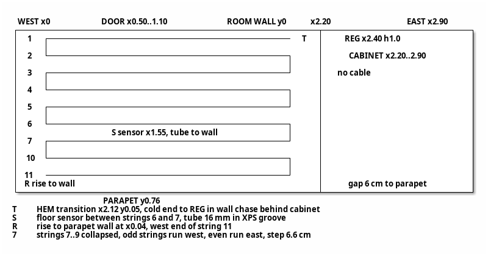
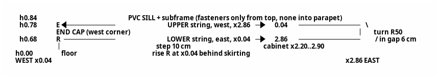

# Мастер-паспорт: тепловая защита и электрообогрев балкона (v2.2)

## 1. Роль
Специалист-теплотехник и строитель.

## 2. Задача

**Цели:**
- устранить конденсат и сквозняки;
- снизить теплопотери через остекление;
- держать на балконе +20…+22 °C при закрытой двери в комнату;
- учесть лето: мобильный кондиционер, перегрев.

**Этапы:**
1. Остекление. Выполнено: ПВХ-окна со стеклопакетами (Р43), ТЗ ред. 5.
2. Электрообогрев: кабель в полу и в парапете под подоконником (сценарий В). Расчёт и схемы выполнены.
3. Далее: детальная технология пола, спецификация, выбор штор.

## 3. Исходные данные

| Параметр | Значение |
|---|---|
| Ориентация, климат | Юго-восток. Краснодар: зима в среднем 0 °C, минимум −15 °C; лето +30 °C, максимум +45 °C |
| Балкон | 2,90 × 0,76 м, высота 2,40 м. Координаты: x — от западного торца; y — от стены комнаты (0) к парапету (0,76); h — от чистого пола |
| Остекление | ПВХ-окна в проёме алюминиевого каркаса, h 0,84…2,36 (1,52 м). Улица 2,90 м: 4 части по ≈ 0,725 м, счёт от востока. Часть 1 глухая; 2 — поворотно-откидная, петли с востока; 3 глухая; 4 — поворотно-откидная, петли с запада. Запад 0,76 м — глухое. Восток 0,76 м — глухое, изнутри ЭППС под шкаф |
| Каркас | Алюминий без терморазрыва. Остаются верхний ригель и угловые стойки внутри угловых соединителей ПВХ. Нижний ригель демонтируется (Р43) |
| Подоконник | ПВХ на стальной обрешётке, поверх — подставочный профиль рамы. Выступ за плоскость ГКЛВ 10 мм |
| Парапет (снаружи внутрь) | Кровельное железо → пенопласт 30 → решётка → ЭППС 30 → Теплоизол 5 (фольга внутрь) → каркас, стойки с шагом 40 см → ГКЛВ 12,5 → отделка |
| Пол (снизу вверх) | Плита → перлитобетон 8–10 см → ЭППС 20 → ЭППС с покрытием 10 → кабель в клее → керамогранит |
| Стена комнаты | Кирпич или бетон, 0,35 м, ненесущая. Дверь x 0,50…1,10, открывается в комнату. Окно комнаты x 1,20…2,50, глухое. Радиатор в комнате при x ≤ 2,10, без термоголовки |
| Шкаф (восток) | Нижняя секция x 2,20…2,90, глубина 0,70, зазор 6 см до парапета. Ниша-полка h ≈ 0,9…1,1, открыта на запад. Верхняя секция x 2,50…2,90. При x 2,20…2,50 стена над нижней секцией открыта |
| Сеть | Линия с УЗО 30 мА, автомат 16 А |
| Бюджет | Без ограничений |

## 4. Решения (действующая редакция)

| № | Решение |
|---|---|
| Р1 (ред.) | Створки зимой закрыты, приток только через клапан (Р45) |
| Р2 | Восточный пролёт изнутри утепляется под шкаф: PIR или ЭППС 30–50 мм, на уплотнитель, без сплошной приклейки |
| Р3 | Отменено, заменено Р43 |
| Р4 | Основное отопление — электрообогрев пол + стена. Конвектор ≈ 0,5–1 кВт с термостатом — резерв в мороз |
| Р5 | Бельё в мороз на балконе не сушится. Влажность ≤ 45–50 % |
| Р6 | Свет зимой не критичен |
| Р7, Р8 (ред.) | «Штора от потолка с прижимом» отменена. Летний режим учитывается (Р13) |
| Р13 (ред.) | Натяжное плиссе или кассетные жалюзи на леске, на каждую часть, крепление на штапик. Без боковых направляющих и уплотнения, зазор у стекла 1–2 см. Тип — открытый вопрос |
| **Р17 (ред. 2)** | Один регулятор, без ограничителя стены. **Полоса h 0,62…0,84 свободна от мебели и предметов.** Крепёж в парапет ниже подоконника (h 0…0,84) запрещён. Зазор 6 см за шкафом открыт сверху и снизу |
| Р18 | Регулятор ТеплоСофт E51.716 (IP20, от −5 до +50 °C) в накладной коробке: x ≈ 2,40, h 1,0, в нише над шкафом |
| Р25 | Управляет встроенный датчик воздуха. Выносной датчик пола ограничивает 30 °C. Калибровка по термометру в центре на h 1,2 (±0,5 °C). Зимой дежурный режим ≥ +10 °C, летом регулятор выключен |
| Р26 | Розетка переносится: x ≈ 2,15, h 0,30. Регулятор питается шлейфом от её клемм |
| Р29 | Холодный конец, гофра датчика и питание — в штробах стены комнаты за нижней секцией шкафа |
| **Р20, Р39 (ред. 2)** | Подъём в западно-уличном углу. **Нижняя нитка h 0,68** на восток до x 2,86, разворот в зазоре за шкафом, **верхняя нитка h 0,78** на запад, концевая заделка в западном углу |
| Р34 | На стене без теплоизоляции и фольги под кабелем, кабель полностью в клее |
| Р38 | Hemstedt DR 12,5 Вт/м: Ø 4,5 мм, R изгиба ≥ 25 мм, холодный конец 4 м, 2 × 1,0, монтаж при t ≥ +5 °C. В плиточном клее, без стяжки |
| Р33 (ред. 3) | DR 30 м, ≈ 375 Вт: пол ≈ 23,3 м (11 ниток), стена ≈ 6,7 м (2 нитки). DR 24 м мал, DR 80 м избыточен |
| Р40 | Стена: кабель на ГКЛВ без штроб, клей для тёплых полов → шпаклёвка по сетке → флизелин, слой ≤ 8 мм |
| Р41 | Пол: утапливающий слой клея 6–7 мм + облицовочный 4–5 мм |
| Р42 | Гофра датчика пола — в пазу ЭППС |
| Р43 | ПВХ-окна в проёме каркаса, 3 пролёта. Профиль 58–70 мм, ≥ 3 камер, Uf ≤ 1,6, предпочтительно 58–60 мм. Пакет 4i-14Ar-4-14Ar-4i (40 мм), при несовместимости — 4i-10Ar-4-10Ar-4i (32 мм). Нижний ригель демонтируется после подтверждения, что он не несущий |
| Р44 | Верхний ригель закрыт пароплотно (≥ 13 °C при −15 °C). Полости угловых узлов утеплены (≥ 10 °C) |
| Р45 | Регулируемый клапан в раме створки 2, зимой 5–10 м³/ч |
| Р46 | Принят сценарий В (пол + стена под подоконником). А и Б отклонены |
| **Р47 (ред.)** | **Пол: шаг ≥ 6 см. Стена: шаг 10 см (минимум 8 см)**: стена без ограничителя, поверхность ≤ 40 °C |

## 5. Теплотехника (ключевые выводы)

| Показатель | Значение |
|---|---|
| Площадь в потерях | 5,56 м² (улица 4,41 + запад 1,16). Восток закрыт шкафом |
| Uw (П58 + 40 мм) | ≈ 1,06. Стекло 67 %, ПВХ 33 %, открытого алюминия нет |
| H, Вт/К | Окно + узлы + парапет 9,0; с притоком 5–10 м³/ч — 10,7–12,4 |
| Потери (приток 5–10 м³/ч) | 225–260 Вт при 0 °C, 385–446 Вт при −15 °C. Приток 20–30 м³/ч съедает выигрыш окон |
| Температуры при −15 °C | Центр стекла 18,2; край пакета 10,9; низ края с ниткой 10,5–11; рама 12,4; угловой узел 10; закрытый ригель 13,8; угол за шкафом с нитками 10–12 °C. Точка росы 9,3 °C |
| Критичные узлы | Низ пакета и угол за шкафом защищает кабель. Угловые узлы и ригель — по Р44. Штору не уплотнять, ночью приподнимать |
| Запасной пакет 32 мм | +0,75 Вт/К, запас у края ≈ 0,5–1 К, допустимо при влажности ≤ 45 % |

## 6. Остекление: история выбора

| Этап | Решение |
|---|---|
| v1.x–v2.0 | Одинарное стекло + сотовое плиссе в направляющих + плёнка (U ≈ 1,7) |
| v2.1 | ПВХ-окна со стеклопакетами (Р43). Сравнение — артефакт 1, ред. 3 |

## 7. Расчёт секции Hemstedt DR 30 м

| № | Параметр | Значение | Обоснование |
|---|---|---|---|
| 7.1 | Зона обогрева пола | x 0…2,20, y 0…0,76; 1,67 м² | Зона шкафа исключена |
| 7.2 | Зона укладки | x 0,04…2,12, y 0,05…0,71 | Отступ от шкафа 8 см, от стен 4–5 см |
| 7.3 | Пол | 11 × 2,08 = 22,9 м + 10 разворотов ≈ 0,4 м ≈ 23,3 м | Нечётное число ниток, финиш в западно-уличном углу |
| 7.4 | Шаг пола | 0,66 / 10 = 6,6 см ≥ 6 см, R 33 мм | Р47 |
| 7.5 | Стена | Подъём ≈ 0,73 + нижняя 2,82 + разворот ≈ 0,16 + верхняя 2,82 + запас ≈ 0,17 ≈ 6,7 м | x 0,04…2,86, h 0,68 / 0,78, шаг 10 см, R разворота 50 мм |
| 7.6 | Мощность | Пол ≈ 291 Вт (≈ 174 Вт/м² на зону); стена ≈ 84 Вт (≈ 125 Вт/м² полосы), из них за шкафом ≈ 16 Вт | 12,5 Вт/м |
| 7.7 | Итого | ≈ 375 Вт при 230 В (≈ 358 Вт при 220 В), ток ≈ 1,6 А | — |
| 7.8 | Поверхности | Пол ≤ 30 °C (датчик), стена ≈ 33–36 °C (≤ 40 °C) | Шаг 10 см |
| 7.9 | Баланс | Полезно ≈ 330–345 Вт, кабель один держит +21 °C до −6…−10 °C | Ниже — конвектор (Р4) |
| 7.10 | Холодный конец | Переход T у x ≈ 2,12, y 0,05, трасса ≈ 1,4 м из 4 м | Укорачивать только холодный конец |
| 7.11 | Подстройка | Восточные развороты пола в пределах x 2,08…2,12 | Греющую часть не резать, длина стены фиксирована |

## 8. Схема пола

>Условные обозначения (Перевод)
>T — переход HEM (муфта) в точке x 2,12, y 0,05. Холодный конец идёт к регулятору в штробе стены за шкафом.
>S — датчик пола между нитками 6 и 7. Гофра 16 мм уложена в пазу ЭППС.
>R — подъём на стену парапета при x 0,04 от западного конца нитки 11.
>7 — нитки 7…9 на схеме свёрнуты. Нечётные нитки идут на запад, чётные — на восток. Шаг 6,6 см.

| Нитка | y, м | Направление |
|---|---|---|
| 1, 3, 5, 7, 9, 11 | 0,05; 0,182; 0,314; 0,446; 0,578; 0,71 | на запад |
| 2, 4, 6, 8, 10 | 0,116; 0,248; 0,38; 0,512; 0,644 | на восток |

| Узел | Исполнение |
|---|---|
| T | x ≈ 2,12, y 0,05, прямой участок, отметить на фото |
| S* | x ≈ 1,55, между нитками 6 и 7 (y ≈ 0,41), гофра 16 мм с заглушкой в пазу ЭППС |
| R | x 0,04, y 0,71 → 0,76, поворот R ≥ 25 мм, демпферная лента подрезается |

**Пирог пола:** ЭППС с покрытием (загрунтован) → демпферная лента → монтажная лента → кабель DR → клей C2 6–7 мм → облицовочный клей 4–5 мм → керамогранит. Подъём пола ≈ 20 мм, нагрев включать через 28 суток.

## 9. Схема стены (парапет, уличная сторона)

## 10. Технология укладки на ГКЛВ (без штроб)

| № | Операция |
|---|---|
| 1 | Найти саморезы подоконника и стойки каркаса (шаг 40 см). **Разметить нитки h 0,68 и 0,78** на x 0,04…2,86, в том числе в зазоре за шкафом (до установки шкафа или со снятой боковиной) |
| 2 | Загрунтовать ГКЛВ. Замерить сопротивление жил и изоляции, записать в протокол |
| 3 | Закрепить кабель монтажной лентой или клипсами на клею. Разворот за шкафом R ≥ 25 мм (по шагу 50 мм), ниток не касаться |
| 4 | Утопить кабель в клей C2 без пустот. Повторный замер |
| 5 | Стеклосетка в шпаклёвку, общий слой ≤ 8 мм, выравнивать весь парапет h 0…0,84. Стык с подоконником — эластичный герметик |
| 6 | Флизелин. Фото-исполнительная схема. Запрет сверления h 0…0,84 |

## 11. ТЗ для подрядчика

Действует **ред. 5** = ред. 4 (артефакт 2) с правкой п. 1.3 и 5.6: «Крепёж в парапет со стороны балкона ниже подоконника (h 0…0,84) запрещён. Подставочный профиль крепится только сверху через подоконник».

Ключевое содержание:
- профиль 58–70 мм, предпочтительно 58–60;
- пакет 40 мм или альтернатива 32 мм;
- угловые узлы утеплены, ригель закрыт;
- шов по ГОСТ 30971;
- клапан в раме створки 2;
- проверка открывания створки 2 у шкафа;
- приёмка по температурам.

## 12. Приёмка

| № | Критерий | Метод |
|---|---|---|
| 1 | Сопротивление в норме до монтажа, после клея, после отделки | Мультиметр, мегаомметр, протокол |
| 2 | Шаг пола ≥ 6 см, шаг стены 10 см (≥ 8), R ≥ 25 мм, пересечений нет | Рулетка, фото |
| 3 | Датчик пола извлекается из гофры | Проба до клея |
| 4 | Пол ≤ 30 °C, стена ≤ 40 °C, воздух +20…+22 °C (±0,5) | ИК-термометр, термометр на h 1,2 |
| 5 | Влажность ≤ 50 %, конденсата на раме и краю пакета нет | Гигрометр min/max, осмотр в мороз |
| 6 | Окна: рама ≥ 12 °C, угловые узлы ≥ 10 °C, ригель ≥ 13 °C (приведено к −15 °C), продувания нет | Тепловизор или дымовая проба (ТЗ ред. 5, п. 5) |

## 13. Открытые вопросы

| № | Вопрос |
|---|---|
| 1 | Высота порога двери: допустим ли подъём пола на ≈ 20 мм? |
| 2 | От какого уровня отсчитана h 0,84 (основание или чистый пол)? Влияет на h ниток |
| 3 | Подходит ли покрытие ЭППС 10 мм под плиточный клей (паспорт) |
| 4 | Тип штор: натяжное плиссе или кассетные жалюзи (Р13) |
| 5 | От подрядчика: марка профиля, фальц под 40 мм, высота подставочного профиля, несущий ли нижний ригель, открывание створки 2 у шкафа |
| 6 | Порядок работ: окна → разметка стены → кабель за шкафом до установки шкафа или со снятой боковиной |

## 14. Статус и следующие шаги

- **Выполнено:** сравнение сценариев (ред. 3), ТЗ ред. 5, расчёт и схемы DR 30 м (пол — шаг 6,6 см, стена — 10 см).
- **Далее:** детальная технология пола, спецификация материалов, выбор и монтаж штор.

## 15. Версионность

| Версия | Изменение |
|---|---|
| 1.0–1.5 | Постановка, Р1–Р8, ранжирование, вариант 2 |
| 1.6 | Геометрия 2,90 × 0,76, шкаф, Р9–Р30 |
| 1.7–1.8 | ТЛБЭ 25 м, стяжка |
| 2.0 | Hemstedt DR 30 м в клее: Р33, Р38, Р40–Р42 |
| 2.1 | Высота остекления 1,52 м. ПВХ-окна: Р43–Р46, Р3 отменено. Редакции Р1, Р7/Р8, Р13, Р17, Р20/Р39, Р33. Р47: шаг ≥ 6 см. ТЗ ред. 5 |
| **2.2** | Шаг стены 10 см: нитки h 0,68 / 0,78 (Р20/Р39 ред. 2), свободная полоса h 0,62…0,84 (Р17 ред. 2), Р47 (ред.) разделён на пол и стену. Обновлены 7.5, 7.6, 7.8, разделы 9, 10.1, 12.2 |